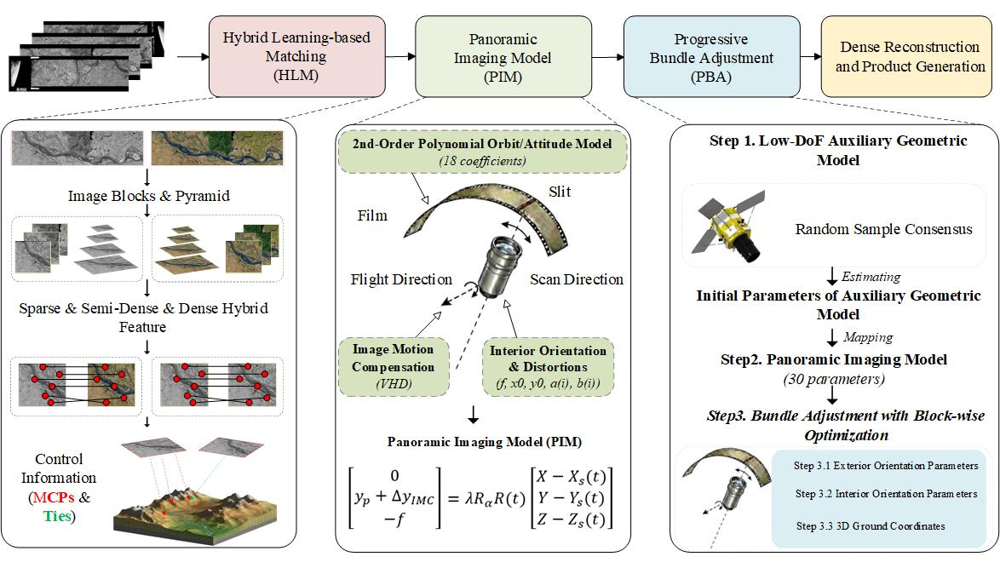
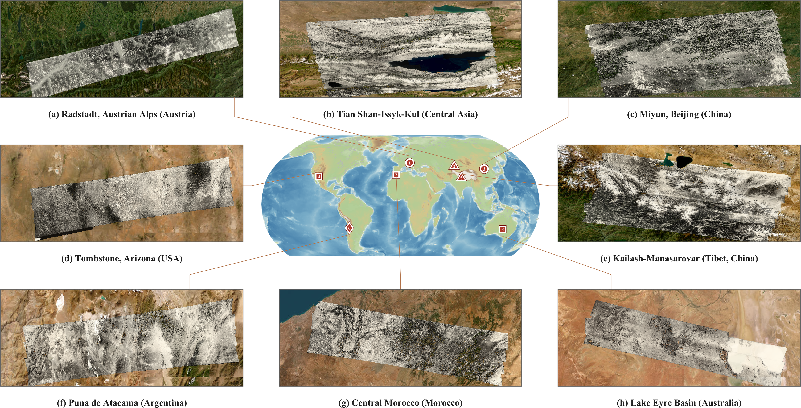
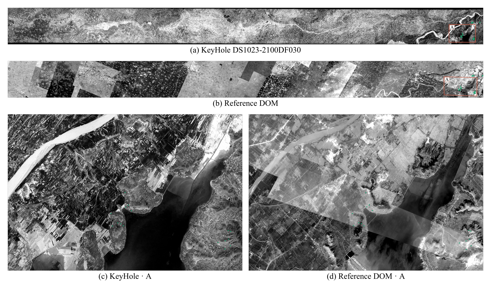
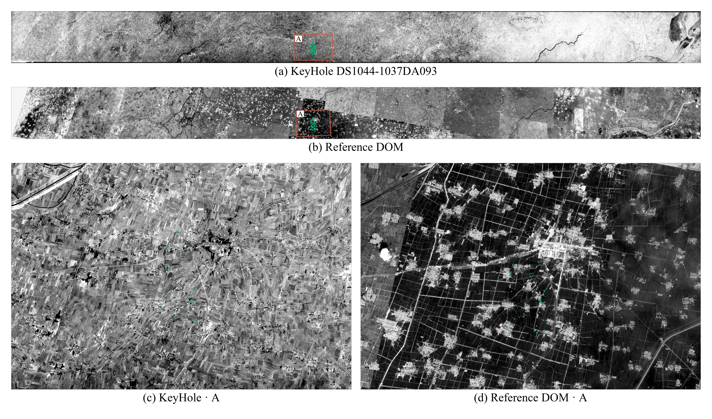

# HisMap

**Metadata-Free Rigorous Georeferencing of Declassified CORONA KH-4 Stereo Imagery via Progressive Bundle Adjustment**

HisMap recovers camera geometry from historical CORONA KH-4 stereo film scans without mission-provided orientation metadata or field-surveyed ground control. Modern orthophotos and elevation data supply ground control through image matching. The recovered geometry supports the reconstruction of historical digital orthophoto maps (DOMs) and digital elevation models (DEMs).

[Method workflow](#method-workflow) · [Historical DOMs](#historical-doms) · [Failure cases](#failure-cases) · [Data and scripts](#data-and-scripts)

## Method workflow

*Figure 4 of the manuscript shows the full workflow, from control extraction to historical product geHisMap-main.zipneration.*

1. **Extract control with hybrid learning-based matching (HLM).** A coarse-to-fine cascade uses SuperPoint + LightGlue, LoFTR, and RoMa. Matches between historical images act as tie points for relative stereo geometry. Matches to the modern reference supply matched control points (MCPs), with horizontal coordinates from the reference DOM and elevations from the reference DEM.
2. **Model the scan with the panoramic imaging model (PIM).** The model represents camera position and attitude as second-order functions of scan time and includes image motion compensation and self-calibrating interior parameters.
3. **Recover geometry with progressive bundle adjustment (PBA).** Fit an equivalent frame camera to the MCPs with RANSAC-based pose estimation. Transfer its pose to the panoramic model, then refine exterior orientation, interior calibration, and 3D tie-point coordinates in stages before a final joint adjustment.
4. **Generate historical products.** Fit rational polynomial coefficients (RPCs) to the adjusted model, reconstruct terrain using semi-global matching, and orthorectify and mosaic the imagery to produce a historical DOM and DEM.

## Historical DOMs

The grayscale overlays in Figure 12 of the manuscript are reconstructed CORONA orthophotos from 1966–1972. Panel (c) shows Miyun within the Beijing study area. The other seven panels show the transferability sites. [Open the full-resolution figure (PNG, 15 MB)](assets/Cross-site-dom.png)

## Failure cases

**Challenging cross-site example.** 
### Image examples

| Failure case 1 | Failure case 2 |
| --- | --- |
|  |  |

## Data and scripts

| Material | Available in this repository |
| --- | --- |
| Historical DOM preview | A multi-site PNG figure for visual inspection of the reconstructed orthophotos. [Cross-site DOM figure](assets/Cross-site-dom.png) |
| Modern reference DOM | Beijing's horizontal reference was derived from Google Earth imagery acquired around 2012. The repository points to Google Earth Pro. [Reference access note](data/google-earth-dom.md) |
| Beijing CORONA frame list | The 22 frame IDs for the Beijing block. Use them to search the USGS EarthExplorer archive. [Frame list (CSV)](data/BJ_Keyhole_Download_List.csv) · [USGS EarthExplorer](https://earthexplorer.usgs.gov/) |
| Ames Stereo Pipeline (ASP) examples | Optical-bar baseline command templates for camera initialization and bundle adjustment. They require Keyhole imagery, camera files, control and tie-point inputs, and a reference DEM. [Old OpticalBar](scripts/asp/ASP%28Old%20OpticalBar%29.sh) · [New OpticalBar](scripts/asp/ASP%28New%20OpticalBar-CoSP%29.sh) |

## Contact

For questions about the HisMap study, data, or permissions, contact [zhuoluhou@whu.edu.cn](mailto:zhuoluhou@whu.edu.cn).

## Rights and reuse

This repository is intended for public presentation and academic discussion. **All rights in original copyright-protected figures, visualizations, annotations, and related project materials are reserved by their respective rights holders.**

No additional permission is granted for reproduction, redistribution, modification, or commercial use of such protected materials without authorization, except as permitted by applicable law or GitHub's terms.

Underlying historical imagery and third-party materials retain their respective copyright status and usage conditions, including any applicable public-domain status. Separate licenses or permissions already granted for particular materials are not superseded by this statement.
