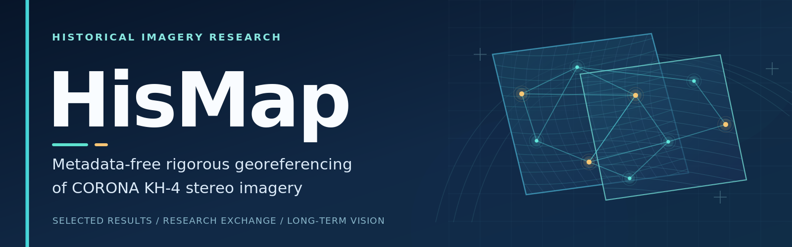

<!--
HisMap project showcase README.
Before publishing: replace [JOURNAL NAME] and [CONTACT EMAIL].
For double-anonymous review, confirm whether public author-identifying material is permitted.
Insert only imagery/results cleared for public display, with appropriate provenance and rights statements.
Uncomment the gallery only after the files are actually uploaded.
-->

  

  
  &nbsp;
  
  &nbsp;
  

  <strong>HisMap · Research Results & Academic Discussion</strong> 
  <em>Toward reliable and generalizable processing of diverse historical imagery.</em>

  <a href="#overview">Overview</a> &nbsp;·&nbsp;
  <a href="#selected-results">Results</a> &nbsp;·&nbsp;
  <a href="#manuscript">Manuscript</a> &nbsp;·&nbsp;
  <a href="#research-vision">Vision</a> &nbsp;·&nbsp;
  <a href="#discussion--contact">Contact</a>

---

## Overview

**HisMap** is a research study on **metadata-free rigorous georeferencing of declassified CORONA KH-4 stereo imagery via progressive bundle adjustment**.

This repository is intended to present selected georeferencing results associated with the HisMap study and to support academic exchange on the processing of historical imagery.

| **Imagery** | **Research problem** | **Methodological focus** |
|:---|:---|:---|
| Declassified CORONA KH-4 stereo imagery | Metadata-free rigorous georeferencing | Progressive bundle adjustment |

> [!NOTE]
> **Research scope:** The current HisMap study investigates CORONA KH-4 stereo imagery. Extending reliable processing to other types of historical imagery is a longer-term research objective, not a capability established by this study.

## Selected Results

This section is reserved for carefully selected georeferencing examples and quantitative illustrations associated with the HisMap study. Only material approved for public display will be included, with appropriate image-source attribution and figure captions.

<!--
FEATURED RESULT: Once a rights-cleared image named assets/results/featured-result.png
has been uploaded, replace the paragraph above with a short description,
then uncomment the following block.

  

<b>Featured result.</b> [Describe the study area, comparison, source imagery, and relevant validation information.]

-->

<!--
TWO-CASE GALLERY: Upload the two approved images first and then uncomment.

| **Case study 01** | **Case study 02** |
|:---:|:---:|
|  |  |
| [Study area · what is compared · image credit] | [Study area · what is compared · image credit] |
-->

<!--
OPTIONAL VALIDATION: Only include an accuracy figure if it reports a metric
and evaluation setting actually used in the study.

### Georeferencing Validation

[Metric, unit, validation data, and evaluation setting.]

-->

## Manuscript

**HisMap: Metadata-Free Rigorous Georeferencing of Declassified CORONA KH-4 Stereo Imagery via Progressive Bundle Adjustment**

<!-- Do not add DOI, volume, pages, acceptance or publication claims before they are confirmed. -->

## Research Vision

Historical imagery provides valuable evidence for studying environmental, geographical, and landscape changes across time. Its geometric processing is challenging because sensor characteristics, acquisition conditions, and available metadata vary substantially.

Building on research involving CORONA KH-4 stereo imagery, our long-term goal is to **advance robust, transferable approaches for processing diverse historical imagery** across sensors, platforms, and acquisition periods.

We welcome discussions on the technical challenges, research opportunities, and potential collaborations that can contribute to this goal.

## Discussion & Contact

We welcome academic discussions related to **historical satellite imagery, photogrammetry, geometric modelling, and rigorous georeferencing**.

- **Contact:** [CONTACT EMAIL]

<!--
After enabling Discussions in Settings > General > Features, uncomment this line:
- **GitHub Discussions:** [Join the discussion](https://github.com/Zhoulu-Hou/HisMap/discussions)
-->

## Rights & Reuse

This repository is intended for public presentation and academic discussion. **All rights in original copyright-protected figures, visualizations, annotations, and related project materials are reserved by their respective rights holders.**

No additional permission is granted for reproduction, redistribution, modification, or commercial use of such protected materials without authorization, except as permitted by applicable law or GitHub's terms.

Underlying historical imagery and third-party materials retain their respective copyright status and usage conditions, including any applicable public-domain status. Separate licenses or permissions already granted for particular materials are not superseded by this statement.

For permissions or collaboration inquiries, please use the contact information above.
